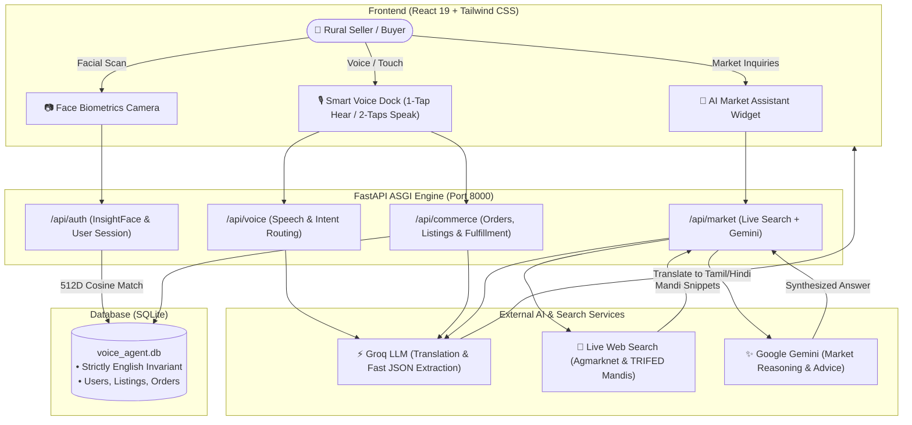

# 🌾 Kural Voice Agent — Voice-First Rural & Tribal Commerce Platform

> **A high-contrast, multilingual, voice-first e-commerce and market intelligence ecosystem empowering rural producers and buyers across India through conversational AI, biometric authentication, and live mandi price grounding.**

---

## 📑 Table of Contents
1. [Overview](#-overview)
2. [Key Capabilities & Features](#-key-capabilities--features)
3. [Dual-AI & Multimodal Architecture](#-dual-ai--multimodal-architecture)
4. [System Architecture & Data Flow](#-system-architecture--data-flow)
5. [Tech Stack](#-tech-stack)
6. [Repository Structure](#-repository-structure)
7. [Prerequisites](#-prerequisites)
8. [Environment Configuration (`.env`)](#-environment-configuration-env)
9. [Step-by-Step Installation & Run Guide](#-step-by-step-installation--run-guide)
   - [Backend Setup (FastAPI)](#1-backend-setup-fastapi)
   - [Frontend Setup (React + Vite)](#2-frontend-setup-react--vite)
10. [Database Migrations & Verification](#-database-migrations--verification)
11. [API Endpoints Reference](#-api-endpoints-reference)
12. [Troubleshooting & FAQs](#-troubleshooting--faqs)

---

## 🌟 Overview

The **Kural Voice Agent** is built specifically for rural producers, tribal artisans, and agricultural buyers. Many existing e-commerce systems present steep barriers for rural users due to complex text interfaces, English-only database schemas, and rigid form layouts.

**Kural** eliminates these hurdles by introducing:
- **Natural Voice-First Navigation:** A persistent, double-tap interactive microphone dock with real-time speech feedback and auto-commit capabilities.
- **Multilingual UI with English-Backend Invariant:** Users speak and read in their native language (**Tamil**, **Hindi**, or **English**), while all catalog data, order states, and database records remain canonically standardized in English.
- **Passwordless Face Biometric Authentication:** Onboarding and sign-in powered by InsightFace AI with fallback support for a large 10-key numeric dialpad.
- **Stateless AI Market Assistant:** Live mandi and MSP price intelligence grounded via duckduckgo scraping of official **Agmarknet** and **TRIFED** portals, synthesized in real-time by **Google Gemini**.
- **Sunlight-Readable High-Contrast Light Theme:** Designed for bright outdoor environments with clean white surfaces (`#FFFFFF`), crisp black typography (`#0F172A`), and vivid call-to-action buttons.

---

## 🚀 Key Capabilities & Features

### 1. 🎙️ Smart Voice Dock & Hands-Free Interaction
- **Dual-Tap Microphone Control:** 
  - `1 Tap`: Listen to assistant speech synthesis (TTS).
  - `2 Taps`: Activate microphone input for hands-free speech recognition.
- **Floating & Dockable Widget:** Can be minimized, dragged anywhere on screen, or docked to the left or right side of the screen to avoid obscuring underlying content.
- **Spoken Error Recovery & Guidance:** Contextual audio prompts guide the user through every single step.

### 2. 🌐 Multi-Language Architecture (Vernacular Frontend ↔ English Backend)
- **Supported Languages:** Tamil (`ta-IN`), Hindi (`hi-IN`), and English (`en-US`).
- **Canonical Standardization:** Whether a seller says *"தேன்"* (Tamil), *"शहद"* (Hindi), or *"Wild Honey"*, the system recognizes the product, maps it canonically to `"Wild Forest Honey"`, and stores it in standard English units in SQLite.
- **Real-Time Vernacular Translation:** Dynamic prompts, catalog titles, pricing, and order status updates are automatically translated back to the user's preferred language.

### 3. 👤 Face Biometric Login & Dual-Mode Onboarding
- **Zero-Password Authentication:** Users capture a single frame via their device camera; InsightFace extracts a 512-dimensional facial embedding and matches with cosine similarity ($\ge 0.60$).
- **Dual-Mode Fallback:** Users can opt for standard onboarding:
  - Step 1: Spoken or typed Name.
  - Step 2: Spoken or quick-chip Village/Town selection.
  - Step 3: 10-digit mobile number entry via an accessible on-screen numpad.

### 4. 📦 Complete Dual-Sided Commerce Lifecycle

#### For Sellers:
- **Dual-Input Product Listing:** Choose between a guided 3-step Voice Wizard (Product $\rightarrow$ Quantity $\rightarrow$ Price) or a standard typed form.
- **Safety Guardrail Modal:** Spoken confirmation dialog before publishing any product to prevent accidental submissions.
- **Incoming Orders Notification Drawer:** Dedicated side panel displaying incoming buyer orders with single-tap or voice-activated **Accept**, **Pack**, and **Schedule Delivery Pickup** actions.

#### For Buyers:
- **Voice-Powered Semantic Search:** Search by speaking or typing naturally (e.g., *"Show me organic turmeric under ₹200"*).
- **Interactive Quantity Slider:** Real-time stock validation and price calculations.
- **10-Second Escrow Payment Loader:** Simulated visual countdown with one-click emergency cancellation before settlement.
- **Live 5-Stage Fulfillment Tracker:** Tracks orders seamlessly from `Order Placed` $\rightarrow$ `Payment Completed` $\rightarrow$ `Packed` $\rightarrow$ `Shipped` $\rightarrow$ `Delivered`.

### 5. 🤖 Grounded AI Market Assistant (Agmarknet & TRIFED)
- **Live Price Verification:** When a user asks *"What is the price of honey today?"*, the backend executes live searches against **Agmarknet** and **TRIFED** government portals.
- **Direct Prompt Injection:** Live search snippets are directly injected into **Google Gemini**, giving users accurate mandi prices, APMC benchmarks, and seasonal tips.
- **Stateless & Ephemeral:** Conversation history is stored in React component state only; no permanent chat logs clutter the database.

---

## 🧠 Dual-AI & Multimodal Architecture

| AI Component | Engine / Model | Purpose |
| :--- | :--- | :--- |
| **Translation & Fast Extraction** | **Groq API** (`llama-3.3-70b-versatile` / `llama-3.1-8b-instant`) | Ultra-low latency (<400ms) structured JSON extraction of product names, quantities, and Tamil/Hindi bidirectional translations. |
| **Live Market Intelligence** | **Google Gemini** (`gemini-3.8-flash`, `gemini-flash-latest`) | Deep conversational synthesis of live web search snippets, mandi rates, and farmer guidance. |
| **Speech-to-Text (STT)** | **Web Speech API** / **Groq Whisper** (`whisper-large-v3`) | Live real-time audio transcription with multilingual speech recognition. |
| **Text-to-Speech (TTS)** | **HTML5 SpeechSynthesis** / **gTTS** | High-fidelity voice output in Tamil, Hindi, and Indian English accents. |
| **Face Biometrics** | **InsightFace** (`buffalo_sc` ONNX) | 512-dimensional facial vector extraction running locally on CPU. |

---

## 📐 System Architecture & Data Flow



---

## 🛠️ Tech Stack

### Frontend
- **Framework:** [React 19](https://react.dev/) + [Vite 8](https://vitejs.dev/)
- **Routing:** [React Router 7](https://reactrouter.com/)
- **Styling:** [Tailwind CSS v4](https://tailwindcss.com/)
- **APIs:** HTML5 Web Speech API, WebRTC MediaStreams, Canvas API

### Backend
- **Framework:** [FastAPI](https://fastapi.tiangolo.com/) (Python 3.10+)
- **Server:** [Uvicorn](https://www.uvicorn.org/) (ASGI)
- **Database:** SQLite via [SQLAlchemy 2.0](https://www.sqlalchemy.org/)
- **Data Validation:** [Pydantic v2](https://docs.pydantic.dev/)

### Machine Learning & Web Scraping
- **Face Recognition:** [InsightFace](https://github.com/deepinsight/insightface) (`buffalo_sc`), [ONNX Runtime](https://onnxruntime.ai/), OpenCV
- **LLM SDKs:** `google-generativeai`, `groq`
- **Web Scraping:** `urllib`, `beautifulsoup4`

---

## 📁 Repository Structure

```text
├── backend/
│   ├── app/
│   │   ├── core/
│   │   │   ├── config.py             # Environment configuration & settings
│   │   │   └── database.py           # SQLAlchemy SQLite connection & session
│   │   ├── models/
│   │   │   ├── user.py               # User table & face embedding blob
│   │   │   ├── listing.py            # Product listings (English canonical)
│   │   │   ├── order.py              # Orders, fulfillment states & tracking
│   │   │   └── interest.py           # Buyer-seller interactions
│   │   ├── routers/
│   │   │   ├── auth.py               # Face registration & face login endpoints
│   │   │   ├── commerce.py           # Step validation, orders, inventory, tracking
│   │   │   ├── market.py             # Live Agmarknet/TRIFED market assistant
│   │   │   └── voice.py              # Speech synthesis and prompt endpoints
│   │   ├── services/
│   │   │   ├── face_auth.py          # InsightFace model loader & cosine matcher
│   │   │   ├── localization.py       # Tamil/Hindi/English translation dictionary & Groq fallback
│   │   │   ├── market_assistant.py   # Live web scraping & Gemini prompt synthesis
│   │   │   └── voice_service.py      # Audio processing & STT helpers
│   │   └── main.py                   # FastAPI app entry point, CORS & routing
│   ├── models/                       # Downloaded InsightFace models (buffalo_sc)
│   ├── migrate_db.py                 # SQLite database schema migration script
│   ├── migrate_ecommerce_flow.py     # Schema update for 5-stage fulfillment flow
│   ├── test_ecommerce_e2e.py         # End-to-end integration test suite
│   └── voice_agent.db                # SQLite database instance
├── frontend/
│   ├── src/
│   │   ├── components/
│   │   │   ├── AuthActionSelect.jsx  # Login vs Register selection
│   │   │   ├── BuyerCheckout.jsx     # Quantity checkout & 10s payment countdown
│   │   │   ├── BuyerCommerceView.jsx # Product search, discovery & order placing
│   │   │   ├── BuyerDashboard.jsx    # Buyer stats & home actions
│   │   │   ├── BuyerOrderHistory.jsx # Past orders & fulfillment receipts
│   │   │   ├── CameraView.jsx        # WebRTC camera feed with alignment guide
│   │   │   ├── FaceEnrollment.jsx    # Facial vector enrollment flow
│   │   │   ├── FaceLogin.jsx         # 1-tap facial scan login
│   │   │   ├── LanguageSelect.jsx    # Vernacular selection (Tamil, Hindi, English)
│   │   │   ├── MarketAssistantWidget.jsx # Floating AI chatbot window
│   │   │   ├── RoleSelect.jsx        # Choose Buyer vs Seller role
│   │   │   ├── SellerCommerceView.jsx# Dual-input listing form & voice wizard
│   │   │   ├── SellerDashboard.jsx   # Seller tiles & live incoming orders drawer
│   │   │   ├── SellerListings.jsx    # Active seller inventory management
│   │   │   ├── SellerOrderHistory.jsx# Completed sales & earnings
│   │   │   ├── SmartVoiceDock.jsx    # Draggable bottom mic dock with live speech feedback
│   │   │   └── VoiceOnboarding.jsx   # Fallback onboarding (Name, Village, Phone)
│   │   ├── context/
│   │   │   └── SmartVoiceContext.jsx # Global voice state, TTS & speech recognition provider
│   │   ├── utils/
│   │   │   ├── api.js                # Axios/Fetch API wrapper
│   │   │   └── voiceMatcher.js       # Fuzzy keyword matching for voice commands
│   │   ├── App.jsx                   # Route configuration
│   │   ├── index.css                 # High-contrast light theme CSS rules
│   │   └── main.jsx                  # React DOM mount point
│   ├── package.json
│   └── vite.config.js
├── .env                              # API keys & configuration
├── .gitignore
├── requirements.txt                  # Python dependencies
└── README.md                         # Project documentation
```

---

## 📋 Prerequisites

Before running the project, ensure you have the following installed on your machine:
- **Python:** Version `3.10` or higher ([Download Python](https://www.python.org/downloads/))
- **Node.js:** Version `18.0.0` or higher & `npm` ([Download Node.js](https://nodejs.org/))
- **Hardware Access:** A working **webcam** (for face authentication) and **microphone** (for voice interaction).
- **Modern Web Browser:** Google Chrome, Microsoft Edge, or Safari with Web Speech API and WebRTC support.

---

## 🔑 Environment Configuration (`.env`)

Create a `.env` file in the project root directory (same directory where `requirements.txt` is located):

```env
# Google Gemini API Key (for Live Mandi Market Assistant)
# Obtain from: https://aistudio.google.com/
GEMINI_API_KEY="your_google_gemini_api_key_here"

# Groq Cloud API Key (for fast multilingual translations & extraction)
# Obtain from: https://console.groq.com/
GROQ_API_KEY="your_groq_api_key_here"

# Database Configuration
DATABASE_URL="sqlite:///./voice_agent.db"

# Face Authentication Threshold (Cosine Similarity 0.0 - 1.0)
FACE_SIMILARITY_THRESHOLD=0.60
```

> [!NOTE]
> The configuration system accepts both uppercase (`GEMINI_API_KEY`, `GROQ_API_KEY`) and lowercase (`gemini_api_key`, `groq_api_key`) variable names.

---

## 🏃 Step-by-Step Installation & Run Guide

### 1. Backend Setup (FastAPI)

#### A. Open Terminal in the Project Root:
```bash
cd "r:/project/bit/voice agent"
```

#### B. Create & Activate a Python Virtual Environment:
- **Windows (PowerShell):**
  ```powershell
  python -m venv venv
  .\venv\Scripts\Activate.ps1
  ```
- **macOS / Linux:**
  ```bash
  python3 -m venv venv
  source venv/bin/activate
  ```

#### C. Install Python Dependencies:
```bash
pip install --upgrade pip
pip install -r requirements.txt
```

#### D. Initialize / Migrate the Database:
Run the migration script to populate initial sample listings and configure the 5-stage fulfillment schema:
```bash
python backend/migrate_db.py
```

#### E. Start the FastAPI ASGI Server:
```bash
cd backend
uvicorn app.main:app --reload --host 0.0.0.0 --port 8000
```
- The backend API will be available at: **`http://localhost:8000`**
- Interactive Swagger documentation at: **`http://localhost:8000/docs`**

---

### 2. Frontend Setup (React + Vite)

#### A. Open a Second Terminal Window:
```bash
cd "r:/project/bit/voice agent/frontend"
```

#### B. Install NPM Packages:
```bash
npm install
```

#### C. Launch the Development Server:
```bash
npm run dev
```
- Open your browser and navigate to: **`http://localhost:5173`**
- When prompted by the browser, **Allow** access to your Microphone and Camera.

---

## 🧪 Database Migrations & Verification

To verify the complete commerce and fulfillment lifecycle end-to-end, a test suite is provided.

Ensure the backend server is running on port 8000, then execute:
```bash
python backend/test_ecommerce_e2e.py
```

This automated test checks:
1. Direct order creation (`order_placed`) in regional languages.
2. Verification of strict English database invariants in `voice_agent.db`.
3. 10-second payment completion simulation (`payment_completed`).
4. Seller order packaging (`packed`).
5. Delivery dispatch & tracking generation (`shipped`).
6. Buyer delivery confirmation (`delivered`).

---

## 📡 API Endpoints Reference

### 1. Authentication (`/api/auth`)
| Method | Endpoint | Description |
| :--- | :--- | :--- |
| `POST` | `/api/auth/enroll` | Register a new user with face embedding & details |
| `POST` | `/api/auth/login-face` | Authenticate existing user by matching face vector |
| `POST` | `/api/auth/register-manual`| Fallback registration using Name, Village, and Phone |
| `GET`  | `/api/auth/user/{user_id}` | Retrieve profile details for an enrolled user |

### 2. Voice & Localization (`/api/voice`)
| Method | Endpoint | Description |
| :--- | :--- | :--- |
| `POST` | `/api/voice/prompt` | Get localized audio prompt and text for current screen |
| `POST` | `/api/voice/process-intent` | Parse spoken regional command into standardized action |

### 3. Commerce & Fulfillment (`/api/commerce`)
| Method | Endpoint | Description |
| :--- | :--- | :--- |
| `POST` | `/api/commerce/validate-step` | Extract product name/quantity/price from speech |
| `POST` | `/api/commerce/listing/create` | Save new product listing (canonical English) |
| `GET`  | `/api/commerce/listings` | Fetch active catalog items with localized titles |
| `POST` | `/api/commerce/order/create` | Place a new direct order |
| `POST` | `/api/commerce/order/pay` | Complete simulated payment |
| `POST` | `/api/commerce/order/pack` | Seller packs order for fulfillment |
| `POST` | `/api/commerce/order/ship` | Generate tracking ID and schedule pickup |
| `POST` | `/api/commerce/order/deliver` | Mark order as delivered to buyer |
| `GET`  | `/api/commerce/seller/orders/{id}` | Real-time pending orders for seller side-panel |
| `GET`  | `/api/commerce/buyer/orders/{id}` | Order history and receipt breakdown |

### 4. AI Market Assistant (`/api/market`)
| Method | Endpoint | Description |
| :--- | :--- | :--- |
| `POST` | `/api/market/query` | Stateless query with live Agmarknet/TRIFED search + Gemini synthesis |

---

## ❓ Troubleshooting & FAQs

### 1. The Microphone is not picking up my voice
- Check your browser URL bar: click the **tune/lock icon** next to `http://localhost:5173` and ensure **Microphone** is set to **Allow**.
- Remember the gesture: **Double-tap** the bottom microphone to start speaking. When the pulsating red ring appears, speak clearly.
- Note that Chrome and Edge have the most reliable native Web Speech API support.

### 2. Camera feed is black during Face Login / Enrollment
- Ensure no other application (e.g., Zoom, Teams, Camera app) is holding an exclusive lock on your webcam.
- Confirm browser permissions for **Camera** are enabled.

### 3. InsightFace / ONNX Runtime installation errors on Windows
- If `pip install insightface` complains about missing C++ build tools, ensure you have the [Microsoft C++ Build Tools](https://visualstudio.microsoft.com/visual-cpp-build-tools/) installed.
- Pre-downloaded models reside in `backend/models/buffalo_sc/`.

### 4. Market Assistant returns "Live search attempt failed"
- Check that your system has internet connectivity so DuckDuckGo Lite can reach public Agmarknet and TRIFED endpoints.
- If web requests are blocked by a firewall, the system will automatically fall back to official hardcoded MSP benchmarks for honey, turmeric, pepper, cardamom, and other key commodities.

### 5. CORS Errors in the Browser Console
- Ensure the backend is running on `http://localhost:8000` and frontend on `http://localhost:5173`.
- CORS middleware in `backend/app/main.py` is configured to allow requests from both port `5173` and `3000`.

---

## 📄 License
This project is developed for educational, agricultural development, and research purposes. Feel free to customize and extend it for your community and rural commerce initiatives.
